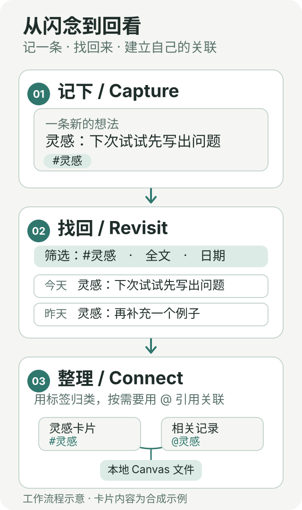
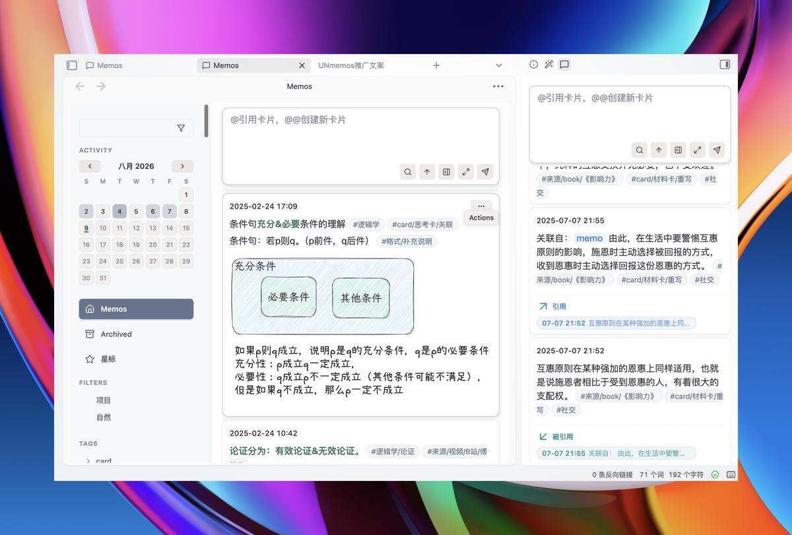
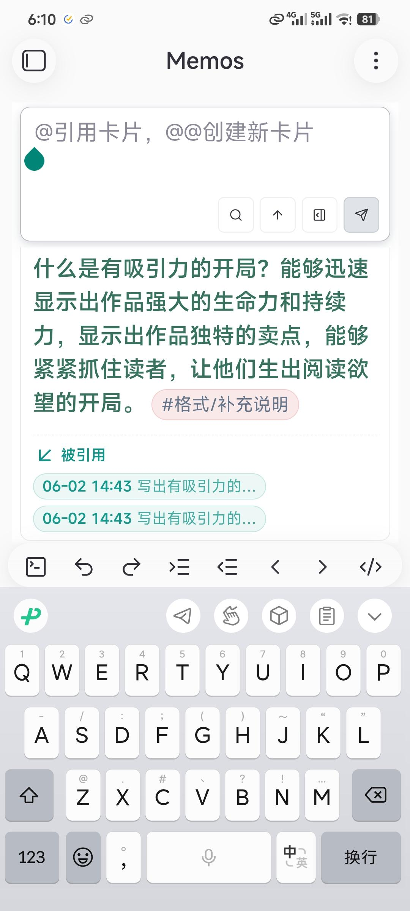

# UNmemos

**Catch a passing thought in Obsidian and find it again in a searchable timeline.** UNmemos is a Memos-inspired flash-note plugin for people who want their quick notes to stay in their vault as ordinary Obsidian Canvas files.

给 Obsidian 用户一个随手记下闪念的地方：写下内容后，它会出现在可搜索的时间线上，并以 Canvas 文件保存在自己的 Vault 里。

> Part of the UN series: **UNmemos** 记 · **UNreader** 读 · **UNagent** 用。

*Capture a thought, find it later by text, tag, or date, and manually connect related notes with @ references. / 记下想法，按全文、标签或日期找回，再用 @ 引用手动关联。 Card text is synthetic; this is not an app screenshot. / 卡片内容为合成示例，并非插件界面截图。*

## What you can do

- Capture short notes and drafts, then browse them by day or activity.
- Find notes with full-text, tag, and date filters; pin, star, or archive useful ones.
- Write `#tags` and use `@` references to connect notes across Obsidian editors.
- Save notes to `UNmemos/{year}.canvas` by default; change the storage path in Settings and open the files directly in Obsidian Canvas.
- Use the Chinese or English interface, with layouts for desktop and narrow screens.

The Settings page includes a guide for asking an AI assistant to move flomo notes into UNmemos. It is a migration guide, not an automatic in-plugin importer.

### Interface examples / 界面示例

*Earlier desktop interface / 较早的桌面界面。 Names and layout may differ from the current release. / 名称和布局可能与当前版本不同。*

*Earlier phone-sized interface / 较早的手机窄屏界面。 This existing screenshot is not a current-device compatibility test. / 此图是已有截图，不代表本次完成了真机兼容性测试。*

## Get started

1. In Obsidian, open **Settings → Community plugins → Browse**, search for **UNmemos**, then install and enable it.
2. Open the command palette with `Cmd/Ctrl+P`, search for **Open feed in new tab** (English) or **新标签页打开卡片流** (Chinese).
3. Type a note in the top input box. Press `Enter` for a new line; press `Cmd/Ctrl+Enter` or the send button to save it.

If you prefer Enter-to-send, enable it in **Settings → UNmemos**; then use `Shift+Enter` for a new line.

You can also find **Quick capture / 快速记录** in the command palette. To use a keyboard shortcut, open **Settings → Hotkeys**, search for the command, and choose a key combination. UNmemos does not set a default open-view or quick-capture shortcut.

## Privacy and compatibility

- Notes are stored in Canvas files inside your vault. UNmemos makes no network requests and collects no telemetry.
- Optional diagnostic logs are off by default and stay in memory unless you choose to export them.
- The published manifest requires Obsidian **1.7.2 or later** and declares support for desktop and mobile Obsidian (`isDesktopOnly: false`).

## Latest version and changes

[UNmemos 1.0.10](https://github.com/UNcore-gh/UNmemos/releases/tag/1.0.10) adds an independent native navigation sidebar, calendar and recent heatmap, attachments in all three editing entry points, image thumbnails and enlarged previews, and individual memo-link previews in ordinary notes. Saving an edit returns to its card. Task toggles and external writes refresh cards, with improved mobile editor and floating-panel bounds.

See the [release history](https://github.com/UNcore-gh/UNmemos/releases) for the published changes and update files. Local work that has not been released is not listed here.

## License

[Source Available License](LICENSE) — commercial use requires a separate license.

---

# 中文说明

**在 Obsidian 里随手记下闪念，再从可搜索的时间线里找回来。** UNmemos 是一款受 Memos 启发的速记插件，适合希望把临时想法直接保存在自己 Vault 中的 Obsidian 用户。记录以普通 Canvas 文件保存。

## 可以用它做什么

- 快速记下想法和草稿，之后按日期或活跃度浏览。
- 按全文、标签和日期查找记录，也可以置顶、星标或归档。
- 在正文中写 `#标签`，并用 `@` 在 Obsidian 编辑器之间关联记录。
- 记录默认保存在 `UNmemos/{年份}.canvas`；可以在设置中更改路径，也能直接用 Obsidian 白板打开。
- 使用中文或英文界面；桌面和窄屏都有相应布局。

设置页提供一份迁移指南，可交给 AI 助手协助迁移 flomo 笔记。它不是插件内置的自动导入器。

## 开始使用

1. 在 Obsidian 打开 **设置 → 社区插件 → 浏览**，搜索 **UNmemos**，安装并启用。
2. 按 `Cmd/Ctrl+P` 打开命令面板，搜索 **新标签页打开卡片流**（中文界面）或 **Open feed in new tab**（英文界面）。
3. 在顶部输入框写下内容。按 `Enter` 换行；按 `Cmd/Ctrl+Enter` 或点击发送按钮保存。

如果更习惯按回车发送，可以在 **设置 → UNmemos** 中开启；开启后按 `Shift+Enter` 换行。

也可以在命令面板搜索 **快速记录 / Quick capture**。如果想用键盘快捷键，打开 **设置 → 快捷键**，搜索对应命令并自行绑定。UNmemos 不预设打开卡片流或快速记录的快捷键。

## 隐私与兼容性

- 记录保存在 Vault 内的 Canvas 文件中。UNmemos 不发起网络请求，也不收集遥测数据。
- 可选诊断日志默认关闭；只有你主动导出时才会离开内存。
- 当前公开版的清单要求 Obsidian **1.7.2 或更新版本**，并声明支持 Obsidian 桌面端和移动端（`isDesktopOnly: false`）。

## 最新版本与更新说明

[UNmemos 1.0.10](https://github.com/UNcore-gh/UNmemos/releases/tag/1.0.10) 新增独立原生导航侧栏、月历与近期热力图、三个编辑入口的附件选择、图片缩略图与放大预览，以及普通笔记中的单条卡片链接预览。编辑保存后会定位到对应卡片；已有卡片的任务勾选和外部写入可即时刷新，并改善手机输入框、浮窗按钮和缩放范围。

已发布的变更和更新文件见 [GitHub Releases 更新记录](https://github.com/UNcore-gh/UNmemos/releases)。尚未发布的本地改动不列在这里。

## 许可证

[Source Available License](LICENSE) —— 商业使用需另行授权。
